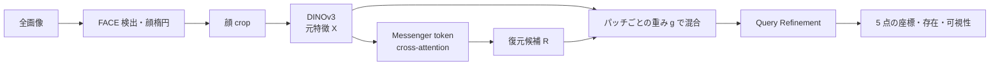

# Messenger token による顔特徴復元

`occlusion` ブランチでは、顔の一部が遮蔽されたとき、同じ顔 crop 内の DINOv3 特徴を参照して各パッチの復元候補を作ります。元特徴と復元候補をパッチごとに混合し、Query Refinement で左右の目・鼻・左右の口角の座標、存在、可視性を推定します。

## 全体構造

以下は E 系列の `256 × 256` crop の例です。DINOv3 ViT-S/16 は `16 × 16` ピクセルを 1 パッチとして扱い、元特徴 `X` を `B × 384 × 16 × 16`（バッチ × チャネル × 高さ × 幅）で出力します。復元候補 `R` と混合後の特徴 `Y` も同じ形です。

## Messenger token と復元器

Messenger token は、復元したい位置から顔 crop 内の特徴を読み出すための学習可能なベクトルです。共有トークンを出力格子の 256 位置に展開し、2D 位置符号を足して cross-attention の query を作ります。Key と value には、同じ crop の DINO 特徴を使います。

| 実装 | 特徴を復元する流れ |
| --- | --- |
| 初期 Messenger | 対象パッチと同じ位置を attention の参照先から外し、他のパッチから特徴を予測します。予測と元特徴の差を投影し、学習した重みで元特徴に加えます。 |
| 連続特徴復元 | 2 層の cross-attention でトークンを更新し、デコーダで各位置の復元候補を作ります。パッチごとに候補の採用重みを求め、元特徴と混合します。 |
| E 系列 | 複数の参照スケールで候補を作り、位置ごとに統合します。統合した特徴をコードブックで量子化し、復号して復元候補 `R` を得ます。 |

### E 系列のマルチスケール処理とコードブック

1. **参照格子を作る。** DINO 最終層の `X` を、スケールごとのストライド付き畳み込みで 96 次元の参照トークンに変換します。factor 1・2・4 の参照格子はそれぞれ `16 × 16`・`8 × 8`・`4 × 4` です。factor 8 を加える比較条件では `2 × 2` も使います。
2. **各位置の候補を統合する。** 各スケールの Messenger token が参照格子に cross-attention をかけ、元と同じ `16 × 16` の出力格子に 384 次元の候補を作ります。位置ごとにスケール間の softmax を取り、候補の重み付き和を求めます。
3. **量子化して復号する。** 統合特徴を 16 次元（E16）または 32 次元（E32）に圧縮します。ベクトルを正規化し、最も近いコードを 8,192 個の辞書から選びます。デコーダと空間補正の両方が量子化後の特徴を入力とし、384 次元の復元候補 `R` を作ります。

## 元特徴との混合と学習

混合は `Y = (1 − g) × X + g × R` で行います。`g` はパッチごとのスカラー（`B × 1 × 16 × 16`）で、同じパッチの全チャネルに適用します。`g = 0` では元特徴を保持し、`g = 1` では復元候補を採用します。生 DINO との比較では、同じ入力と head に `X` を直接渡します。

| 条件 | 学習する部分 | 混合重みと損失 |
| --- | --- | --- |
| 人工遮蔽での E 系列の比較 | 復元器を学習。DINO と keypoint head は固定。 | 人工マスクから作ったパッチ単位の教師を `g` に使います。5 点の位置誤差を主損失とし、遮蔽パッチの clean 特徴との差（MSE・cosine）と VQ の commitment を補助に使います。辞書の EMA 更新は遮蔽パッチが対象です。JS あり条件ではスケール間のコード選択分布の整合性も学習します。 |
| 自然遮蔽 A〜C の設計 | `g` と keypoint head を新規初期化。DINO と復元器は固定。 | 元特徴、復元候補、両者の cosine 差、パッチ座標から `g` を予測します。混合重みを更新する信号は最終座標の位置損失に限定します。head は座標・存在・可視性を学習し、全点欠損の顔は存在判定に使います。 |

自然遮蔽 A〜C は、**自然遮蔽データのみ**、**自然＋従来型人工遮蔽**、**自然＋別動画の顔楕円貼り付け**の3条件です。人工マスクは追加遮蔽の生成と集計に使います。

## 実装と設定

| 内容 | 参照先 |
| --- | --- |
| 初期 Messenger と連続特徴復元 | [Messenger token](keypoint_comparison1/landmark_detection/messenger_recovery.py)・[連続特徴復元](keypoint_comparison1/landmark_detection/continuous_recovery.py)・[設計記録](docs/messenger_continuous_feature_recovery_design.md) |
| E 系列の復元器 | [マルチスケール分岐](src/models/messenger_multiaxis.py)・[コードブック復元](src/models/messenger_codebook_reconstruction.py)・[E16](src/models/messenger_full_e.py)・[E32](src/models/messenger_e32_followup.py) |
| 自然遮蔽の混合 | [パッチ混合ゲート](src/models/natural_feature_gate.py)・[A〜C の学習設計](configs/training_plans/messenger_natural_g_head_common_20261122.json) |
| 学習と比較 | [連続復元の学習](scripts/train_continuous_recovery.py)・[E16 実験](scripts/run_messenger_full_e.py)・[E32 実験](scripts/run_messenger_e32_followup.py) |

学習・評価には、各設定に対応する DINO と baseline の重み、データセット、実験用キャッシュが必要です。
