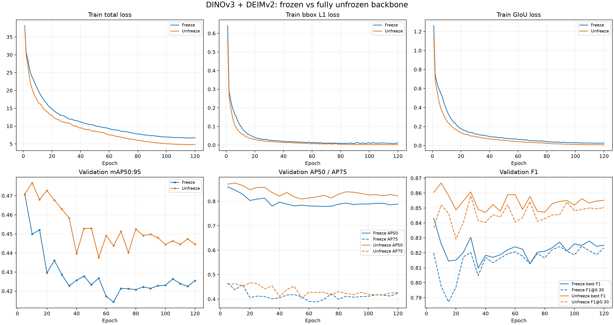

# face_pose_drive_v1 固定データセット比較（2026-07-15）

## 目的と評価規約

3,090 frame の同じ group split を固定し、CNN 系の YOLO11s と ViT 系の
DINOv3 detector を比較する。checkpoint と confidence threshold は validation
だけで選び、独立 test へ一度適用する。test 上で得られる best threshold は参考値に
留め、比較表には使わない。

- train: 2,460 images / 4,027 face boxes
- val: 300 images / 503 face boxes
- test: 330 images / 503 face boxes
- cross-split overlap: source video、SHA-256、image path の全てで 0
- image size: 960
- batch size: 16
- seed: 0
- primary metric: bbox mAP50:95
- operating-point metric: IoU 0.5 の P / R / F1

COCO annotation の SHA-256 は次のとおり。

| split | SHA-256 |
| --- | --- |
| train | `f783ba5bf9f0d5da672b4e34ce46767c2180676c0046dfbf894bf65aff52f423` |
| val | `c2755ce5291c0ee8fdd617c3886e7f8a2f1b2c76f162a91b61cd346708378bd6` |
| test | `cce68a5fef9c7c386cd208cb9a18b2b0fa1e8f54a96e8a5484ccd2adc25eb950` |

## 同一testでのモデル比較

| model | backbone | task | selected epoch | val-selected threshold | mAP50:95 | AP50 | AP75 | P | R | F1 | TP / FP / FN |
| --- | --- | --- | ---: | ---: | ---: | ---: | ---: | ---: | ---: | ---: | ---: |
| DINOv3 + DEIMv2 freeze | ViT-B/16 frozen | bbox | 15 | 0.67 | 0.4562 | 0.8440 | 0.4222 | 0.9313 | 0.7276 | 0.8170 | 366 / 27 / 137 |
| DINOv3 + DEIMv2 unfreeze | ViT-B/16 full fine-tune | bbox | 10 | 0.51 | 0.4760 | 0.8791 | 0.4632 | 0.8957 | 0.8370 | 0.8654 | 421 / 49 / 82 |
| Legacy DINO DEIM-style E1 | ViT-B/16 frozen | bbox | 120 | 0.63 | 0.2560 | 0.6992 | 0.1103 | 0.7995 | 0.6024 | 0.6871 | 303 / 76 / 200 |
| YOLO11s Detect | YOLO11s CNN | bbox | best.pt | 0.52 | 0.4789 | 0.8489 | 0.5215 | 0.9426 | 0.7833 | 0.8556 | 394 / 24 / 109 |
| **YOLO11s Pose** | **YOLO11s CNN** | **bbox + 5 keypoints** | **best.pt** | **0.44** | **0.5332** | **0.8850** | **0.5874** | **0.9501** | **0.8330** | **0.8877** | **419 / 22 / 84** |

現時点では YOLO11s Pose が mAP50:95 と F1 の双方で最良。DINOv3 + DEIMv2
unfreeze は YOLO11s Detect とほぼ同じ mAP だが、AP75 と precision は YOLO11s
Detect、AP50 と recall は DINO unfreeze が高い。freeze から unfreeze への変更では
test mAP が `+0.0198`、F1 が `+0.0484`、recall が `+0.1093` 改善した。

YOLO11s Pose の keypoint test 指標は pose mAP50:95 `0.8327`、NME `0.0609`、
PCK@0.05 `0.5728`、PCK@0.10 `0.8538`。DINO detector と YOLO11s Detect は
keypoint headを持たないため、bbox表とは別に扱う。

Legacy E1 のREADME旧値は「320 px head crop内のface検出」であり、この表は
「960 px full imageのface検出」である。今回の再学習は同じ固定データセットへの転移性を
確認する比較であり、旧値の厳密な再現実験ではない。

## Freeze / unfreeze 学習曲線

validation peakはfreezeがepoch 5のmAP `0.4708`、unfreezeがepoch 10の
`0.4767`。いずれもtrain lossは下がり続ける一方、その後のvalidation mAPは低下する。
約3,000 frameの領域ではbackbone全層更新による改善はあるが小さく、early checkpoint
selectionが必須である。
